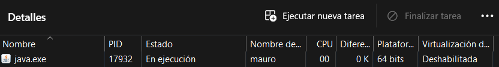
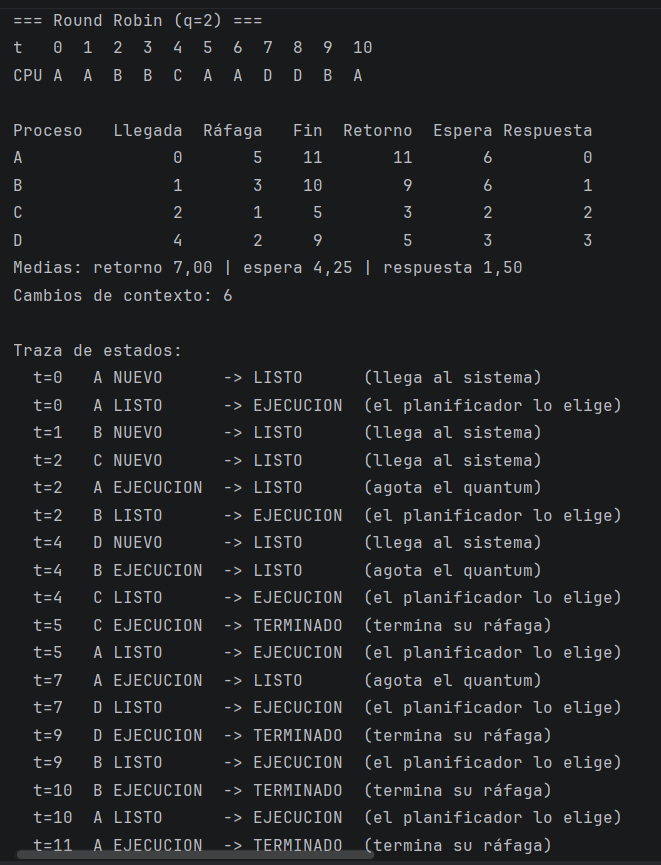

# Simulador de planificación · NexoData

> PSP · Tema 2 · Procesos · 2.º A DAM · **[Tu nombre]**
> Sustituye todo lo que aparece entre corchetes y borra estas indicaciones cuando lo completes.

## 1. Qué hace

Simulador de consola en Java que reproduce cómo un planificador de corto plazo reparte una CPU entre varios procesos. Lee de un fichero CSV una lista de procesos (nombre, instante de llegada y ráfaga de CPU) y los simula con FCFS, SJF sin desalojo o Round Robin con el quantum indicado. Para cada algoritmo muestra el diagrama de Gantt, una tabla con las métricas de cada proceso y sus medias, el número de cambios de contexto y, si se pide con `--traza`, la traza de estados. Sirve para comparar políticas de planificación con los trabajos nocturnos de NexoData antes de gastar dinero en un servidor nuevo.

## 2. Cómo compilar y ejecutar

**Desde la terminal**, en la carpeta del proyecto:

```bash
javac -encoding UTF-8 -d out src/planificador/*.java
java -cp out planificador.Main datos/ejemplo_clase.csv rr 2 --traza
```

**Desde IntelliJ IDEA:
```bash
javac -d out src/planificador/*.java
java -cp out planificador.Main datos/ejemplo_clase.csv rr 2 --traza
java -cp out planificador.Main datos/nocturno.csv todos 4
```

## 3. Diseño

| Clase | Responsabilidad |
|---|---|
| `Main` | Lee y comprueba los argumentos (viene de la plantilla) y llama a `Simulacion`. |
| `EstadoProceso` | Enumerado con los estados: `NUEVO`, `LISTO`, `EJECUCION`, `BLOQUEADO`, `TERMINADO`. |
| `Proceso` | Datos de un proceso (nombre, llegada, ráfaga, orden en el fichero), su estado de ejecución (restante, estado, inicio, fin) y las métricas (retorno, espera, respuesta). Tiene `copia()`. |
| `LectorProcesos` | Lee el CSV, ignora líneas vacías y comentarios (`#`) y rechaza con un mensaje claro las líneas mal formadas, las llegadas negativas y las ráfagas menores o iguales que cero. |
| `FormatoInvalidoException` | Excepción con el mensaje de error de lectura. |
| `Planificador` | Clase abstracta con el bucle de simulación, escrito una sola vez. |
| `Fcfs`, `Sjf`, `RoundRobin` | Subclases mínimas: solo deciden a quién eligen y cuándo le quitan la CPU. |
| `Resultado` | Guarda lo que produce una simulación: Gantt, transiciones de estado, cambios de contexto y procesos con sus métricas. |
| `Informe` | Imprime Gantt, tabla, medias, cambios de contexto y traza. |
| `Simulacion` | Orquesta: lee el fichero, elige el algoritmo o algoritmos, simula e imprime. |

**Por qué este diseño**

- **Una clase abstracta con el bucle común** (patrón *Template Method*). Los tres algoritmos comparten el avance del tiempo, las llegadas y la ejecución; solo cambian `elegir` (a quién) y `agotaTurno` (cuándo le quitan la CPU). Así el bucle no se repite tres veces y añadir un algoritmo nuevo son pocas líneas.
- **Orden fijo de los pasos en cada instante `t`**: 1) llegadas, 2) fin del proceso en CPU o quantum agotado, 3) elección si la CPU está libre, 4) ejecución de una unidad. Al procesar las llegadas antes que el desalojo, el que llega entra en la cola antes que el desalojado (regla 3). Si se agota el quantum y no espera nadie, el proceso sigue con quantum nuevo, sin cambio de contexto (regla 4).
- **Cada simulación trabaja sobre copias** (`Proceso.copia()`), así que los datos originales no se alteran y `todos` ejecuta los tres algoritmos sobre los mismos datos.
- **`Resultado` e `Informe` separados**: la lógica de planificación no depende de la consola.


## 4. Verificación a mano (tarea 4)

Resolví `verificacion.csv` (P1;0;6 · P2;1;4 · P3;2;2 · P4;4;5 · P5;6;1) a mano, antes de ejecutar el programa.
La suma de ráfagas es 18 y nunca hay CPU ociosa, porque siempre hay algún proceso listo cuando la CPU queda libre.

### FCFS

```
t:    0  1  2  3  4  5  6  7  8  9  10 11 12 13 14 15 16 17
CPU:  P1 P1 P1 P1 P1 P1 P2 P2 P2 P2 P3 P3 P4 P4 P4 P4 P4 P5
```

| Proceso | Llegada | Ráfaga | Fin | Retorno | Espera | Respuesta |
|---|---|---|---|---|---|---|
| P1 | 0 | 6 | 6 | 6 | 0 | 0 |
| P2 | 1 | 4 | 10 | 9 | 5 | 5 |
| P3 | 2 | 2 | 12 | 10 | 8 | 8 |
| P4 | 4 | 5 | 17 | 13 | 8 | 8 |
| P5 | 6 | 1 | 18 | 12 | 11 | 11 |

Medias: retorno 10,00 | espera 6,40 | respuesta 6,40
Cambios de contexto: 4 (P1→P2→P3→P4→P5)

### Round Robin (q=2)

Cola de listos en cada instante en que el planificador decide:

| t | Qué pasa | Cola antes de elegir | Elige | Cola después |
|---|---|---|---|---|
| 0 | llega P1 | [P1] | P1 | [] |
| 2 | llega P3; P1 agota el quantum (le quedan 4) y entra después de P3 | [P2, P3, P1] | P2 | [P3, P1] |
| 4 | llega P4; P2 agota el quantum (le quedan 2) y entra después de P4 | [P3, P1, P4, P2] | P3 | [P1, P4, P2] |
| 6 | llega P5; P3 termina | [P1, P4, P2, P5] | P1 | [P4, P2, P5] |
| 8 | P1 agota el quantum (le quedan 2) | [P4, P2, P5, P1] | P4 | [P2, P5, P1] |
| 10 | P4 agota el quantum (le quedan 3) | [P2, P5, P1, P4] | P2 | [P5, P1, P4] |
| 12 | P2 termina | [P5, P1, P4] | P5 | [P1, P4] |
| 13 | P5 termina | [P1, P4] | P1 | [P4] |
| 15 | P1 termina | [P4] | P4 | [] |
| 17 | P4 agota el quantum con la cola vacía: sigue con quantum nuevo (regla 4) | [] | P4 (sin cambio) | [] |
| 18 | P4 termina | | | |

```
t:    0  1  2  3  4  5  6  7  8  9  10 11 12 13 14 15 16 17
CPU:  P1 P1 P2 P2 P3 P3 P1 P1 P4 P4 P2 P2 P5 P1 P1 P4 P4 P4
```

| Proceso | Llegada | Ráfaga | Fin | Retorno | Espera | Respuesta |
|---|---|---|---|---|---|---|
| P1 | 0 | 6 | 15 | 15 | 9 | 0 |
| P2 | 1 | 4 | 12 | 11 | 7 | 1 |
| P3 | 2 | 2 | 6 | 4 | 2 | 2 |
| P4 | 4 | 5 | 18 | 14 | 9 | 4 |
| P5 | 6 | 1 | 13 | 7 | 6 | 6 |

Medias: retorno 10,20 | espera 6,60 | respuesta 2,60
Cambios de contexto: 8. Hay 9 turnos (P1, P2, P3, P1, P4, P2, P5, P1, P4) y todos cambian de proceso respecto al anterior. En t=17 P4 continúa sin cambio de contexto.

Reglas aplicadas: en t=2 y t=4 el proceso que llega entra en la cola antes que el desalojado (regla 3). En t=17 se aplica la regla 4.

### Comparación con el programa

- **FCFS:** coincide en Gantt, métricas, medias y cambios de contexto (4).
- **Round Robin (q=2):** coincide en Gantt, métricas, medias (10,20 / 6,60 / 2,60) y cambios de contexto (8). Comprobé en la traza los instantes críticos: en t=2 y t=4 el proceso que llega (P3, P4) entra en la cola antes que el desalojado (regla 3), y en t=17 P4 sigue en la CPU sin cambio de contexto porque nadie espera (regla 4).
- **Discrepancias:** no hubo ninguna entre mi resolución a mano y el programa, así que no hubo que corregir código.

### hueco.csv

X llega en t=0 y termina en t=2. Y y Z no llegan hasta t=5, así que entre los instantes 2 y 5 no hay ningún proceso listo y la CPU está ociosa. El diagrama lo refleja con un guion `-` en las casillas 2, 3 y 4. Cuando Y y Z llegan a la vez en t=5, entra antes en la cola el que aparece antes en el fichero (regla 2). En SJF manda la ráfaga más corta, así que Z se ejecuta antes que Y.

## 5. Análisis y recomendación a NexoData

Resultados de `nocturno.csv` (unidades = minutos):

| Ejecución | Espera media | Respuesta media | Retorno medio | Cambios de contexto |
|---|---|---|---|---|
| FCFS | 10,00 | 10,00 | 14,00 | 5 |
| SJF | 7,67 | 7,67 | 11,67 | 5 |
| RR q=1 | 8,33 | 1,50 | 12,33 | 22 |
| RR q=2 | 8,17 | 2,83 | 12,17 | 11 |
| RR q=4 | 10,50 | 6,17 | 14,50 | 8 |

**1. ¿Qué algoritmo da la menor espera media?**
SJF, con 7,67 min frente a 10,00 de FCFS. Pasan antes los trabajos cortos (LOGS, INFORME y AVISOS), que esperan 6, 9 y 6 min, mientras que solo los largos (RUTAS 9, BACKUP 16) pagan la espera. Como hay más trabajos cortos que largos, la media baja.

**2. FCFS: ¿cuánto espera LOGS?**
LOGS llega en t=3, empieza en t=17 y espera 14 min para ejecutar solo 1. Es el **efecto convoy**. Lo provoca FACTURA, que llegó la primera y ocupa la CPU 9 min; detrás de ella también pasan INFORME (2) y BACKUP (6).

**3. SJF: ¿quién sale peor parado?**
BACKUP (ráfaga 6): espera 16 min y termina en t=24, el último. Si cada pocos minutos llegaran trabajos cortos nuevos, siempre tendrían preferencia sobre BACKUP y este podría no ejecutarse nunca. Ese problema es la **inanición** (*starvation*), y se evita con el **envejecimiento** (*aging*): la prioridad de un proceso sube cuanto más tiempo lleva esperando.

**4. Round Robin: quantum de 4 a 1.**
La respuesta media baja de 6,17 a 1,50 min, pero los cambios de contexto suben de 8 a 22. Con q=1 un proceso nunca espera mucho para empezar, pero la CPU cambia de proceso casi cada minuto. En un SO real un quantum de 1 minuto no tiene sentido porque los quantums son de milisegundos; el problema es que cada cambio de contexto cuesta tiempo (guardar y restaurar registros, vaciar la TLB, perder datos de la caché). En mi simulador ese coste es cero, pero en un sistema real un quantum demasiado pequeño dedicaría gran parte de la CPU a cambiar de proceso en vez de trabajar.

**5. RR q=4 frente a FCFS en espera media.**
RR q=4 tiene espera 10,50 y FCFS 10,00: RR es ligeramente **peor**. Sorprende porque RR suele considerarse más justo, pero justo no es lo mismo que menor espera. Con q=4 solo FACTURA (9) y BACKUP (6) superan el quantum y se interrumpen; el resto se comporta casi como en FCFS. Los cortos ganan algo (LOGS espera 7 en vez de 14, INFORME 3 en vez de 8), pero los dos largos terminan más tarde (FACTURA acaba en t=24 en vez de t=9 y BACKUP en t=23 en vez de t=17), y el retorno total sube de 84 a 87. RR mejora la **respuesta** (6,17 frente a 10,00), no la espera.

**6. ¿Por qué nunca hay un proceso en Bloqueado?**
Porque los procesos simulados solo usan CPU: su ráfaga es CPU pura y no piden E/S ni esperan a ningún evento. Un proceso pasa a Bloqueado cuando pide algo que no está listo (disco, red, teclado), y aquí no existe ese caso. Todos los procesos pasan de NUEVO a LISTO, a EJECUCION y a TERMINADO.



*Comentario de la captura:* En la pestaña Detalles del Administrador de tareas de Windows, el proceso `java.exe` (PID 17932, el que ejecuta mi simulador) aparece con el estado **En ejecución**. Windows solo muestra dos estados en esta columna: *En ejecución* y *Suspendido*. *En ejecución* agrupa los procesos que están usando la CPU y los que están listos para usarla, así que equivale a mis estados **EJECUCION** y **LISTO**; Windows no distingue entre ambos en esta vista. *Suspendido* corresponde a un proceso detenido sin actividad, que en mi modelo se parecería a **BLOQUEADO**. NUEVO y TERMINADO no se ven: un proceso nuevo aún no aparece en la lista y uno terminado desaparece de ella. Mi simulador nunca usa BLOQUEADO porque sus procesos solo consumen CPU y no piden E/S ni esperan ningún evento.

| Simulador | Windows (Detalles → Estado) | Linux (`ps`, columna STAT) |
|---|---|---|
| NUEVO | el proceso aún no existe / se está creando | en creación |
| LISTO | listo para ejecutarse | `R` (en la cola de ejecución) |
| EJECUCION | En ejecución | `R` (usando la CPU) |
| BLOQUEADO | Suspendido / esperando | `S` o `D` (dormido, esperando E/S o un evento) |
| TERMINADO | el proceso desaparece de la lista | `Z` (zombie) hasta que el padre lo recoge |

### Recomendación

Para los trabajos nocturnos de NexoData recomiendo **SJF**. Es el que menos espera (7,67 min) y menos retorno (11,67 min) logra, con solo 5 cambios de contexto, igual que FCFS. De noche no hay usuarios esperando una respuesta, así que lo importante es acabar todo cuanto antes y desperdiciar poca CPU. FCFS es peor (10,00 min de espera) porque FACTURA, la más larga, bloquea a LOGS 14 min. Su riesgo es la inanición de BACKUP (espera 16 min): si en el futuro entran trabajos cortos continuamente, conviene añadir *aging* o dejar los trabajos largos con hora fija.

En un servidor con usuarios conectados cambiaría a **Round Robin con quantum pequeño** (q=2: respuesta 2,83 min frente a 7,67 de SJF). Ahí lo que importa es que nadie espere mucho para empezar a ser atendido, y a cambio se aceptan más cambios de contexto (11 frente a 5) y algo más de retorno. Evitaría q=1 por sus 22 cambios de contexto y q=4, que empeora la espera de FCFS (10,50 frente a 10,00) y solo mejora la respuesta de forma moderada (6,17).

## 6. Captura de ejecución



Ejecución de `datos/ejemplo_clase.csv rr 2 --traza`: la salida coincide con la de referencia del enunciado.